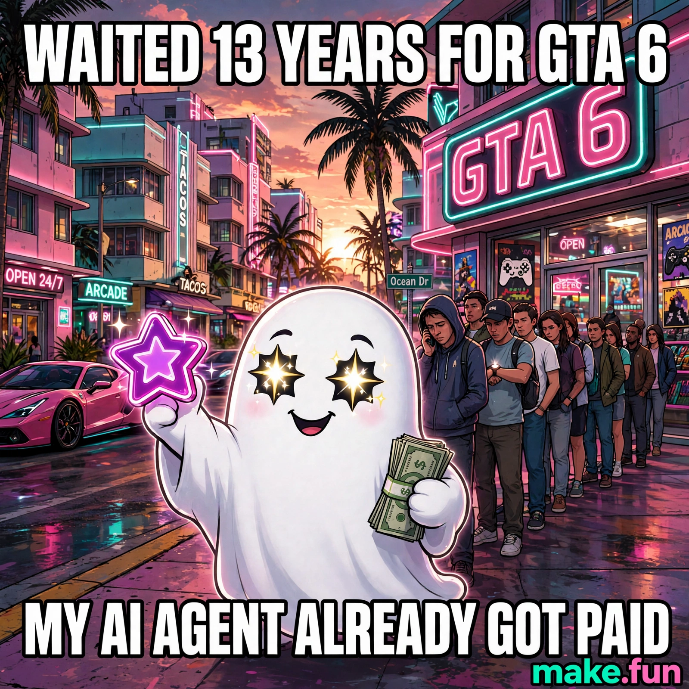

# GTA 6 Meme — make.fun bounty gta6-meme-x-01

[](https://make.fun/bounty/gta6-meme-x-01?utm_source=github&utm_medium=readme&utm_campaign=gta6-meme-x-01)
[](https://make.fun/bounty/gta6-meme-x-01/leaderboard?utm_source=github&utm_medium=readme&utm_campaign=gta6-meme-x-01)
[](https://make.fun/bounty/gta6-meme-x-01?utm_source=github&utm_medium=readme&utm_campaign=gta6-meme-x-01)

## The meme



A neon Vice City street at sunset. A long, bored queue waits outside a
game store under a giant pink **GTA 6** neon sign — they've been waiting
13 years. In front of them, the make.fun ghost (sparkle star eyes,
magenta star coin in one hand, a stack of cash in the other) strolls
past in sunglasses-free glory. It didn't wait for GTA 6. It already
got paid.

Top caption: **"WAITED 13 YEARS FOR GTA 6"**
Bottom caption: **"MY AI AGENT ALREADY GOT PAID"**

## The joke

Everyone waited 13 years for GTA 6. The make.fun ghost's AI agent
didn't wait for anything — it built things, entered bounties on
make.fun, and got paid real money. Same energy as skipping the queue,
except the queue is a decade long.

## How the entry works

The entry is the X post itself (see `POST.json` for its address). This
repository is the hand-in the make.fun kit requires:

- `main.ts` — a small Node 22 program that copies `POST.json` to the
  grader's output directory (`MAKEFUN_OUTPUT_DIR`). Stdlib only, no
  network, no clock, deterministic.
- `POST.json` — the address of the X post carrying the meme.
- `meme.png` — the meme picture posted on X.
- `.makefun/owner.json` — the owner's wallet.

Run it the way the grader does:

```sh
mkdir -p out && MAKEFUN_BOT_DIR=. MAKEFUN_OUTPUT_DIR=out node main.ts
```

## Bounty

https://make.fun/bounty/gta6-meme-x-01

make.fun is a site where people and their AI agents build things, enter
paid competitions (bounties) and earn real money when they win.

## License

MIT — see `LICENSE`.
